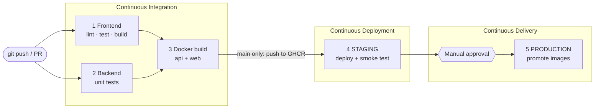

# CI/CD pipeline for Sentinel Platform

Workflow file: [`.github/workflows/ci-cd.yml`](../.github/workflows/ci-cd.yml)

Sentinel is a three-tier app (React/Vite frontend, Express API, MongoDB). The pipeline
builds, tests and ships all three as Docker images and demonstrates the three practices
from the experiment in a single workflow.



## How each concept maps to the pipeline

| Concept | Where it is in the pipeline | What triggers it |
|---|---|---|
| **Continuous Integration** | Jobs 1-3: lint, unit tests, production build, Docker build | Every push and every pull request, on any branch |
| **Continuous Deployment** | Job 4: `deploy-staging` starts the whole stack from the just-built images and runs smoke tests | Automatic on every green push to `main`; no human involved |
| **Continuous Delivery** | Job 5: `deploy-production` promotes the already-tested images to `latest` / `release-N` | Pauses until a reviewer approves (GitHub Environment protection rule) |

Key idea: **images are built once** (tagged `sha-<commit>`) and the *same artifact* is
tested in staging and then promoted to production by re-tagging. Nothing is rebuilt.

## What the pipeline checks

| Stage | Command | What it proves |
|---|---|---|
| Lint | `npm run lint` (oxlint) | React hook rules, code quality |
| Frontend tests | `npm test` | Every nav item has a matching route |
| Backend tests | `cd backend && npm test` | PCA anomaly engine behaves correctly (incl. spike detection) and both ESA seed datasets are consistent |
| Build | `npm run build` | The Vite bundle compiles; uploaded as a build artifact |
| Docker | `docker buildx build` x2 | Both Dockerfiles are valid |
| Smoke test | `scripts/smoke-test.sh` | Mongo seeded, API healthy, PCA endpoint works, frontend served and proxies `/api` |

Run the same checks locally:

```bash
npm ci && npm run lint && npm test && npm run build
cd backend && npm ci && npm test
docker compose up --build          # full stack; web on :8080, API on :4000
scripts/smoke-test.sh              # (in another terminal)
```

## One-time GitHub setup (about 3 minutes)

1. Push the repo to GitHub (the repo must contain `.github/workflows/ci-cd.yml` at its root).
2. **Settings -> Actions -> General -> Workflow permissions**: select *Read and write permissions*
   (lets the pipeline push images to the GitHub Container Registry).
3. **Settings -> Environments -> New environment**: create `staging` (leave defaults).
4. Create a second environment named `production`, enable **Required reviewers**, and add yourself.
   - Note: required reviewers on *private* repos need a paid GitHub plan. Public repos can use it for free.
5. (Optional) Add a repository secret `DEPLOY_HOOK_URL` if you have a host that redeploys when called.

If you skip step 3-4, GitHub auto-creates the environments on first run, but production will
**not** wait for approval, so it would behave as continuous deployment.

## Demo script

**Scene 1: CI catches a bug (Continuous Integration)**

```bash
git checkout -b demo/broken
```
Open `src/data/navigation.js` and change `"/runs"` to `"/run"` (a typo that breaks navigation), then:
```bash
git commit -am "Break runs route" && git push -u origin demo/broken
```
Open a pull request. The *Frontend* job turns red with
`No <Route path="run"> found for nav item /run` and the later jobs are skipped.
Revert the change, push again, and everything turns green.

**Scene 2: Continuous Deployment to staging**

Merge the pull request into `main`. Watch the Actions graph: CI jobs pass, images are pushed
to GHCR, then **4 · Deploy to STAGING** runs on its own: it starts MongoDB, seeds it,
starts the API and web containers, and runs six smoke tests. No approval needed.

**Scene 3: Continuous Delivery to production**

The run then stops at **5 · Release to PRODUCTION** with *"Waiting for review"*.
Click **Review deployments -> production -> Approve and deploy**. The images are promoted
and the run summary shows the release tag. Check *Repository -> Deployments* to see the history of
both environments, and *Packages* to see `sha-…`, `latest` and `release-N` tags.

**Scene 4: Turn Continuous Delivery into Continuous Deployment**

Edit the `production` environment and remove the required reviewer. Push another commit:
the same pipeline now goes all the way to production with no human step. The only difference
between the two practices is that one approval gate.

## Troubleshooting

| Symptom | Fix |
|---|---|
| `denied: permission_denied: write_package` in the Docker job | Step 2 of setup (read and write workflow permissions) |
| Staging cannot pull images | The `docker` job only pushes on pushes to `main`, not on PRs or other branches |
| Production does not wait for approval | The `production` environment has no required reviewer |
| `smoke-test.sh: bad interpreter` | The script was committed with Windows line endings; `.gitattributes` in this repo prevents that, so re-add the file |
